



 

<a href="https://github.com/dameliac">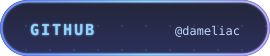</a>&nbsp;&nbsp;<a href="https://www.linkedin.com/in/dameliac">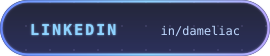</a>

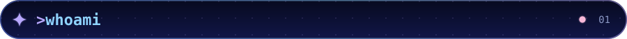 whoami" />

I'm a Computer Science graduate passionate about developing practical software, designing intuitive interfaces, and automating business processes.

My interests span application development, the Microsoft Power Platform, UI/UX design, and cybersecurity. I enjoy turning real-world problems into useful, well-designed technology.

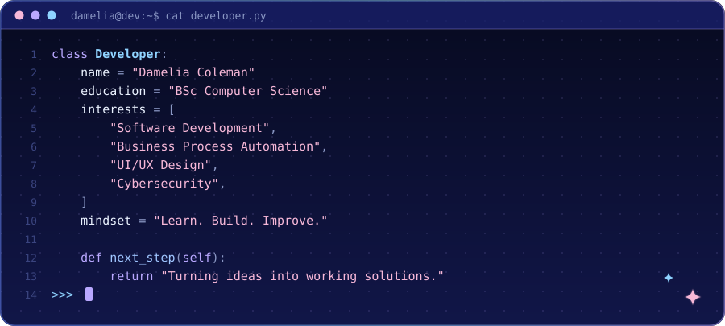

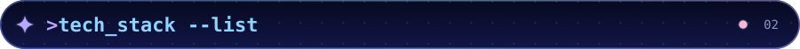 tech_stack --list" />

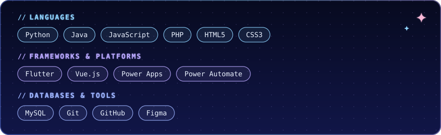

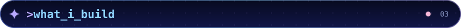 what_i_build" />

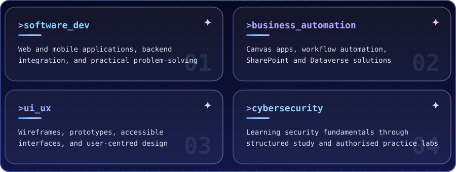

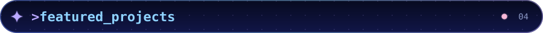 featured_projects" />

<a href="https://github.com/dameliac?tab=repositories">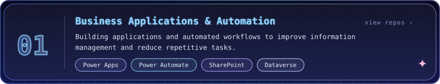</a>

<a href="https://github.com/dameliac?tab=repositories">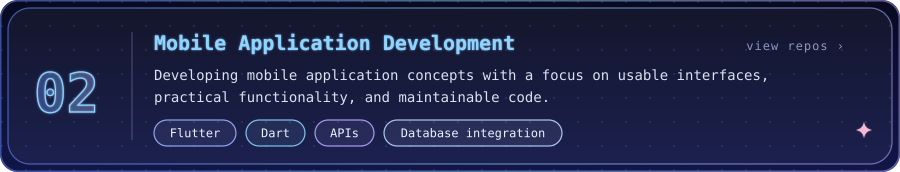</a>

<a href="https://github.com/dameliac?tab=repositories">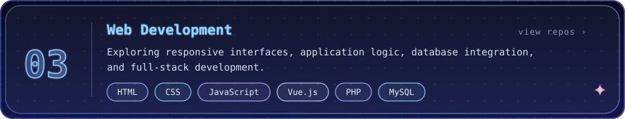</a>

<a href="https://github.com/dameliac?tab=repositories">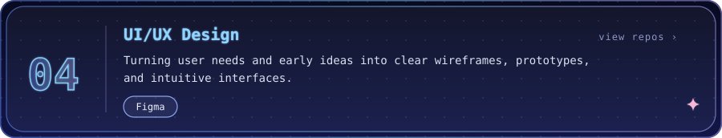</a>

<a href="https://github.com/dameliac?tab=repositories">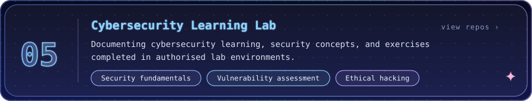</a>

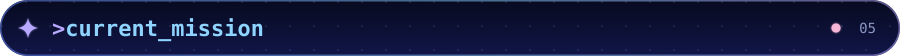 current_mission" />

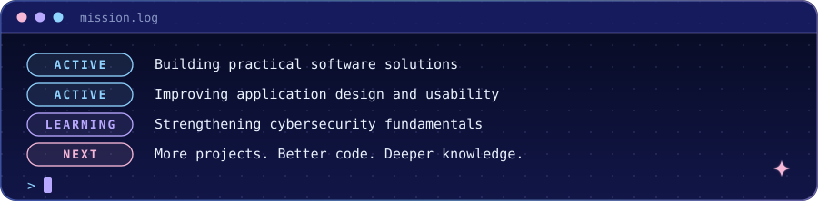

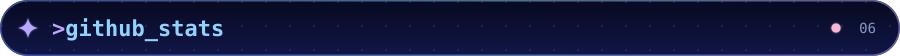 github_stats" />

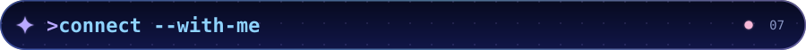 connect --with-me" />

I'm interested in connecting with developers, designers, cybersecurity professionals, and people building useful technology.

- **GitHub:** [@dameliac](https://github.com/dameliac)
- **LinkedIn:** [Connect with me](https://www.linkedin.com/in/dameliac)
<!-- - **Portfolio:** [Visit my portfolio](ADD_PORTFOLIO_URL_HERE) -->

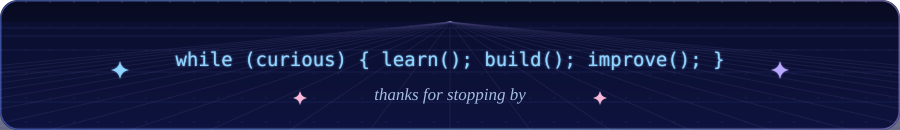
